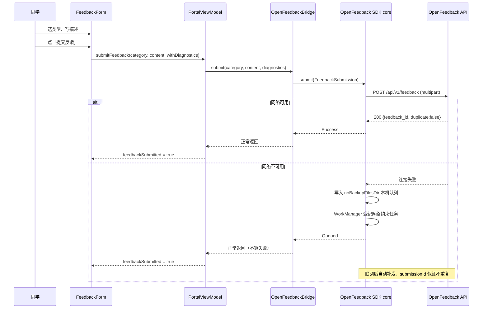

# 反馈通道迁移到 OpenFeedback 统一服务：设计说明

- 日期：2026-11-05
- 状态：实施中
- 对应提案：`proposal.md`

## 目标

把 Android 端的反馈提交从「Chaquopy → Python → requests → 飞书 webhook」
换成「OpenFeedback SDK core → HttpURLConnection → OpenFeedback 服务」，
拿到统一后台、截图、离线重试，并让 APK 里不再携带任何服务端凭据。

## 架构

```
┌──────────────────────────────────────────────────┐
│ OIT-Net-Portal Android                            │
│                                                  │
│  PortalScreen → FeedbackForm（UI 不变）            │
│        │                                         │
│        ▼                                         │
│  PortalViewModel.submitFeedback(...)              │
│        │  FeedbackBridge 边界（不变）              │
│        ▼                                         │
│  OpenFeedbackBridge                              │
│        │                                         │
│        ▼                                         │
│  openfeedback-core                               │
│    ├─ FeedbackApiClient（HttpURLConnection）        │
│    ├─ FeedbackQueue（noBackupFilesDir 本机队列）      │
│    └─ FeedbackUploadWorker（WorkManager + 指数退避） │
└───────────────────────┬──────────────────────────┘
                        │ HTTPS multipart/form-data
                        ▼
        OpenFeedback API（FastAPI + SQLite）
```

## 为什么保留 `FeedbackBridge` 边界

`FeedbackBridge` 是现有代码里已经确立的契约（「只暴露提交一条反馈这一个动作」）。
保留它意味着：

- `PortalViewModel` 一行都不用改；
- 回滚只需换回 `ChaquopyFeedbackBridge.create(...)`；
- 表单 UI 与文案继续由 OIT 自己掌控，不被 SDK 的实现绑住。

代价是 OIT 暂时用不到 SDK 自带的 Compose 反馈窗口。
这正是把 `openfeedback-core` 与 `openfeedback-compose` 拆成两个模块的原因：
需要自己 UI 的宿主只依赖 core。

## 提交流程



**关键语义**：断网时反馈进本机队列，**不算提交失败**，同学看到的仍是「已收到」。
这是与原来飞书直发最大的体验差别：原来弱网提交失败后只有一次机会。

## 幂等与去重

每次提交生成一个 `submissionId`（UUID），在入队与上传之间保持不变。
服务端对 `(app_id, submission_id)` 建唯一约束：

- 重复提交返回原记录（`duplicate: true`），不新建行；
- 因此「上传成功但响应丢了 → 客户端重试」不会产生重复反馈。

## 诊断信息

诊断摘要仍然由 OIT 自己的 `sanitizeDiagnostics()` 过滤（白名单前缀 +
整行丢弃敏感行），再交给 SDK。SDK 不读 OIT 的数据库，也不自动收集 logcat。

`FeedbackForm` 里的「附带诊断信息」开关保持不变，默认关闭。

## 设备信息

SDK 自动附带：App 版本、App build 号、Android 版本、API Level、
制造商、型号、语言。**不含** IMEI、序列号、MAC 地址、位置、账号信息。
这些信息在 OIT 的表单里没有单独展示（OIT 用自己的表单），
但服务端会存下来，作者在后台看得到。

## 依赖策略

- SDK 用 `HttpURLConnection`，**不引入** OkHttp / Retrofit；
- OIT 的依赖树只多了一个 `openfeedback-core`；
- SDK 的 `minSdk` 是 26，OIT 也是 26，兼容；
- SDK 用 Kotlin 2.0.21 + Compose BOM 2024.12.01，与 OIT 一致。

## SDK 从哪里来

`settings.gradle.kts` 里声明一个 Maven 仓库，地址由 Gradle 属性
`oit.openfeedback.mavenUrl` 决定，默认指向 OpenFeedback 服务端的
`/maven/` 静态仓库。版本固定为 `0.1.0`，不用动态版本号。

本地联调时可用文件仓库覆盖：

```bash
./gradlew -Poit.openfeedback.mavenUrl=file:///path/to/OpenFeedback/android-sdk/maven-repo ...
```

## 风险与回滚

| 风险 | 缓解 |
|---|---|
| 服务端地址配错 | 通道不可用时反馈入口提示「反馈通道尚未配置」，不静默失败 |
| 服务端不可达 | 进本机队列，联网自动重试；同学无感 |
| SDK 与 OIT 的 Kotlin 版本冲突 | SDK 用与 OIT 相同的 Kotlin 2.0.21 / BOM |
| 回退 | 把 `MainActivity` 的桥接换回 `ChaquopyFeedbackBridge.create(...)`；服务端把 `oit-net-portal` 置为 `enabled=false` 立即停收 |
